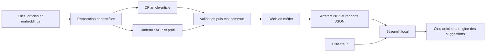
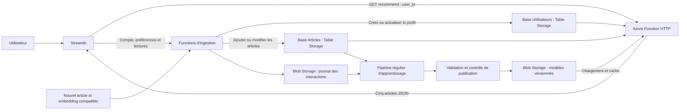

# Architecture de My Content

## Besoin et prototype actuel

Proposer cinq articles à un utilisateur, comparer deux approches distinctes et choisir selon la pertinence et la capacité à intégrer des articles sans clics. Les données fournissent des identifiants, catégories, dates et embeddings ; les titres et textes sont absents.

| Brique actuelle | Entrée | Fonction | Sortie |
|---|---|---|---|
| Données source | Fichiers Globo.com | Conserver interactions et caractéristiques d'origine | Données locales inchangées |
| Préparation | Clics et métadonnées | Contrôler les identifiants, filtrer les lignes invalides et définir les fenêtres | Données contrôlées et bilan qualité |
| Collaboratif article–article | Matrice utilisateurs × articles | Apprendre les cosinus comportementaux et 50 voisins par article | Scores collaboratifs |
| Contenu | Embeddings et dix dernières lectures | Ajuster l'ACP avant validation, calculer profils et cosinus | Scores de contenu |
| Évaluation | Modèles et clics futurs | Comparer pertinence, diversité, repli et nouveaux articles sur les mêmes cas | Résultats distincts de validation et test |
| Décision métier | Validation et exigence d'articles entrants | Choisir une méthode répondant à l'exigence déclarée | Méthode et justification |
| Export | Modèles et profils | Sauvegarder catalogue, profils, voisins et décision | NPZ et rapports JSON |
| Streamlit | Utilisateur, méthode et date | Appeler le moteur, afficher cinq suggestions et comparer les approches | Démonstration locale |

## Cible serverless Azure

Le moteur de prédiction dépend de NumPy. L'entraînement reste séparé : aucune matrice collaborative n'est reconstruite pendant une requête utilisateur.

| Brique cible | Responsabilité fonctionnelle |
|---|---|
| Streamlit | Transmettre l'identifiant, afficher les recommandations et conserver les secrets côté serveur |
| Azure Function HTTP | Valider l'identifiant, charger la version du modèle et renvoyer cinq articles distincts avec la méthode choisie |
| Blob Storage des modèles | Stocker artefacts et métriques versionnés, conserver une version de retour arrière |
| Base Utilisateurs | Stocker identifiant, préférences, dernières lectures, profil, version et date de mise à jour |
| Base Articles | Stocker identifiant, catégorie, publication, disponibilité et référence de l'embedding |
| Functions d'ingestion | Créer ou modifier utilisateurs et articles, contrôler les champs et journaliser les événements |
| Journal des interactions | Conserver les consultations et impressions horodatées nécessaires aux apprentissages et mesures |
| Pipeline régulier | Actualiser profils et voisins ; reproduire la cadence d'évaluation de six heures |
| Contrôle de publication | Comparer les métriques et vérifier exclusions et cinq résultats avant de publier |

### Mise à jour de la base Utilisateurs

1. **Création :** enregistrer un identifiant avec historique vide. Les deux méthodes utilisent le repli commun ; aucune personnalisation n'est revendiquée.
2. **Préférence :** enregistrer les articles appréciés. Le contenu construit un profil avec leurs embeddings. Le collaboratif utilise les voisins déjà appris pour ces articles.
3. **Lecture :** ajouter un événement horodaté et actualiser les dernières lectures et les articles déjà vus. Le profil est recalculé et versionné ; les voisins collaboratifs sont reconstruits par le pipeline régulier.
4. **Correction ou suppression :** actualiser ou supprimer le profil et appliquer la politique de conservation aux événements associés.

### Mise à jour de la base Articles

1. **Création :** ajouter identifiant unique, catégorie, date et disponibilité.
2. **Embedding :** fournir un vecteur compatible et appliquer l'ACP enregistrée. Sans encodeur compatible, l'article n'est pas déclaré prêt pour le contenu.
3. **Publication :** actualiser le catalogue et la version de l'artefact. Le contenu peut classer l'article sans clic ; le collaboratif attend les interactions puis son actualisation.
4. **Modification ou retrait :** actualiser métadonnées, embedding et disponibilité, puis invalider les caches concernés.

Ces bases et l'ingestion sont une cible à implémenter. Le prototype utilise les fichiers et le modèle exporté ; la saisie d'une préférence dans l'interface est une simulation.

## Contrat prévu pour la fonction

Requête : `GET /api/recommend?user_id=123`. La fonction appellera `model.recommend(123)` avec la méthode enregistrée. La réponse contiendra `user_id`, `method`, `article_ids` (cinq identifiants), `articles`, `history`, `reference_time` et `fallback_count`.

Le plan envisagé est Flex Consumption avec zéro instance « always ready ». Le modèle sera chargé une fois par processus depuis Blob Storage privé, avec identité managée. Le déploiement et l'appel HTTP réel seront vérifiés dans la phase suivante ; aucune ressource Azure n'est créée ici.

Références : [Azure Functions Python](https://learn.microsoft.com/en-us/azure/azure-functions/functions-reference-python), [Azure Table Storage](https://learn.microsoft.com/en-us/azure/storage/tables/table-storage-overview), [Flex Consumption](https://learn.microsoft.com/en-us/azure/azure-functions/flex-consumption-plan).
